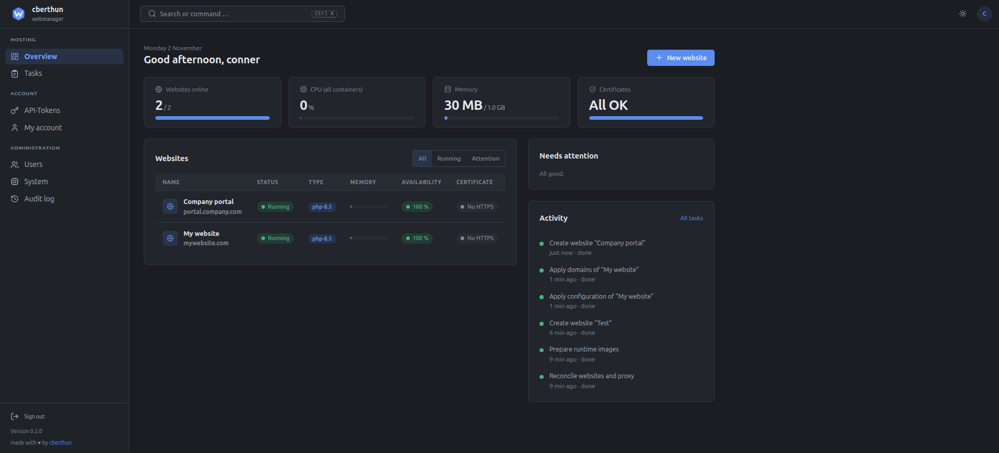
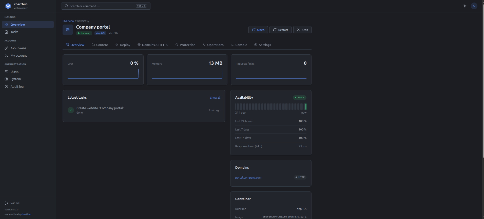
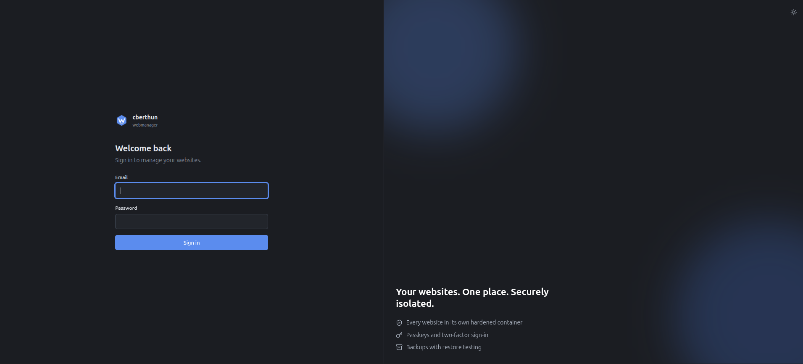

<p align="center">
  
</p>

<h1 align="center">webmanager</h1>

<p align="center">
  A self-hosted hosting control panel built on Docker – every website runs in its own hardened container.
</p>

<p align="center">
  <a href="https://github.com/Drimzo-Development/WebManager/releases/latest"></a>
  <a href="https://github.com/Drimzo-Development/WebManager/actions/workflows/ci.yml"></a>
  <a href="LICENSE.md"></a>
</p>

<p align="center">made with <span>♥️</span> by <a href="https://github.com/Drimzo-Development">Drimzo Development</a></p>

---

One central dashboard manages any number of websites (static, PHP, Laravel, Node.js, Express, Next.js). Runs on
**Debian 13, Debian 12 and Ubuntu 24.04 LTS** (x86_64 and aarch64).

## Screenshots

<p align="center">
  
</p>
<p align="center">
  
</p>
<p align="center">
  
</p>

## Features

* **Websites** in their own containers: own network, own UID, `cap_drop ALL`, read-only file system, resource limits
* **File manager** with editor, **Git/archive deploy**, npm/Composer commands, **cron jobs**, encrypted environment variables
* **HTTPS** with Let's Encrypt, domains, DNS check, automatic renewal
* **Database per website** (MariaDB or PostgreSQL) with Adminer access
* **Protection**: password protection for websites, IP/country rules, rate limiting, WAF, security headers, automatic bans
* **Dashboard security**: Argon2id, 2FA (TOTP), passkeys (WebAuthn), roles (administrator, operator, viewer), API tokens
* **Statistics, logs, weekly report**, email notifications, **backups** with an external target (rclone) and an automatic restore test
* **Updates from the project's own update server** – the dashboard checks every 2 hours, with backup, checksum, GPG signature and automatic rollback
* Custom appearance (name, logo, colour), dark and light theme, translatable interface (English, German; more languages are a JSON file)

The complete description is in the **[manual](docs/MANUAL.md)**.

## Installation

Requirements: a server with root access (2 GB RAM recommended), ports 80/443 free. Docker is installed if needed.

```bash
# 1. Download the latest release from the update server and verify it
BASE="https://updates.drimzo.cc/webmanager/stable"
VERSION=$(curl -fsSL "$BASE/LATEST")
curl -fsSLO "$BASE/webmanager-$VERSION.tar.gz"
curl -fsSLO "$BASE/webmanager-$VERSION.tar.gz.sha256"
curl -fsSLO "$BASE/webmanager-$VERSION.tar.gz.asc"
sha256sum -c "webmanager-$VERSION.tar.gz.sha256"

# Verify the signature. Release key fingerprint: 06965753 7E9E022F2772 0408A3052C73 D13AFAF5
curl -fsSL https://raw.githubusercontent.com/Drimzo-Development/WebManager/main/keys/release.asc | gpg --import
gpg --fingerprint hello@drimzo.cc      # must show the fingerprint above
gpg --verify "webmanager-$VERSION.tar.gz.asc" "webmanager-$VERSION.tar.gz"

# 2. Extract and install
tar -xzf "webmanager-$VERSION.tar.gz" && cd "webmanager-$VERSION"
sudo ./install.sh
```

The installer asks for the email and password of the first administrator and sets everything up. Afterwards the dashboard is reachable at
`http://SERVER-IP/` – **set up a domain with HTTPS under “System & settings” right away**.

Unattended: `sudo ./install.sh --yes --domain panel.example.com --admin-email admin@example.com --admin-password-file /root/admin.pw`.
All options: `./install.sh --help`.

## Updates and versions

* The server asks the update server `updates.drimzo.cc` **every 2 hours** (`webmanager-updatecheck.timer`). New versions
  show up as a notice in the dashboard (and optionally by email).
* **Update source**: `https://updates.drimzo.cc/webmanager/stable` – fixed in the code, not configurable. The server only transports the
  files; the GPG signature (`keys/release.asc` of the installed version) decides whether an update is accepted.
* **Update**: button *System & settings → Updates → Update now* or `sudo /opt/webmanager/update.sh`.
  Flow: backup (configuration + database) → download → SHA-256/GPG check → build → migrations → health checks → automatic rollback on errors.
* **Automatic updates** for patch versions are optional (off by default); the server never installs new feature versions on its own.
* Versions follow [Semantic Versioning](https://semver.org/); changes are listed in the [CHANGELOG](CHANGELOG.md) and in the release notes.

Details, offline update and rollback: [manual → Updates](docs/MANUAL.md#updates-and-releases).

## Development

```bash
git clone https://github.com/Drimzo-Development/WebManager.git && cd webmanager
(cd agent && npm test)         # agent: validation, proxy rendering, update logic
(cd workers && npm ci && npm test)   # worker
(cd frontend && npm ci && npm run build && npm test)   # interface (Preact + TypeScript)
for t in tests/*.test.php; do php "$t"; done            # PHP tests
for t in tests/*.test.sh;  do bash "$t"; done          # shell tests
```

Layout: `app/` (PHP dashboard), `agent/` (the only Docker access), `workers/` (tasks), `frontend/` (interface),
`docker/` (images), `scripts/` (install, update, backup), `templates/`, `database/migrations/`.
A release is created by pushing a tag – see [CONTRIBUTING.md](CONTRIBUTING.md).

## Security

Threat model and measures: [docs/SECURITY.md](docs/SECURITY.md). Please do **not** report vulnerabilities publicly but as described in
[.github/SECURITY.md](.github/SECURITY.md).

## License

WebManager is licensed under the [Elastic License 2.0](LICENSE.md). You may **use, copy, modify and distribute** it, also commercially
inside your own company, for example to run your own and your customers' websites. You may **not offer it to third parties as a hosted
or managed service** that gives them access to a substantial part of its features, and you may not remove or obscure the notices of the
licensor, including “made with ♥ by Drimzo Development” (see [NOTICE](NOTICE.md)). The text in [LICENSE](LICENSE.md) is authoritative.
This is a *source-available* license, not an open-source license in the sense of the OSI. For other uses please get in touch via
[github.com/Drimzo-Development](https://github.com/Drimzo-Development).

---

<p align="center">made with ♥️ by <a href="https://github.com/Drimzo-Development">Drimzo Development</a></p>
